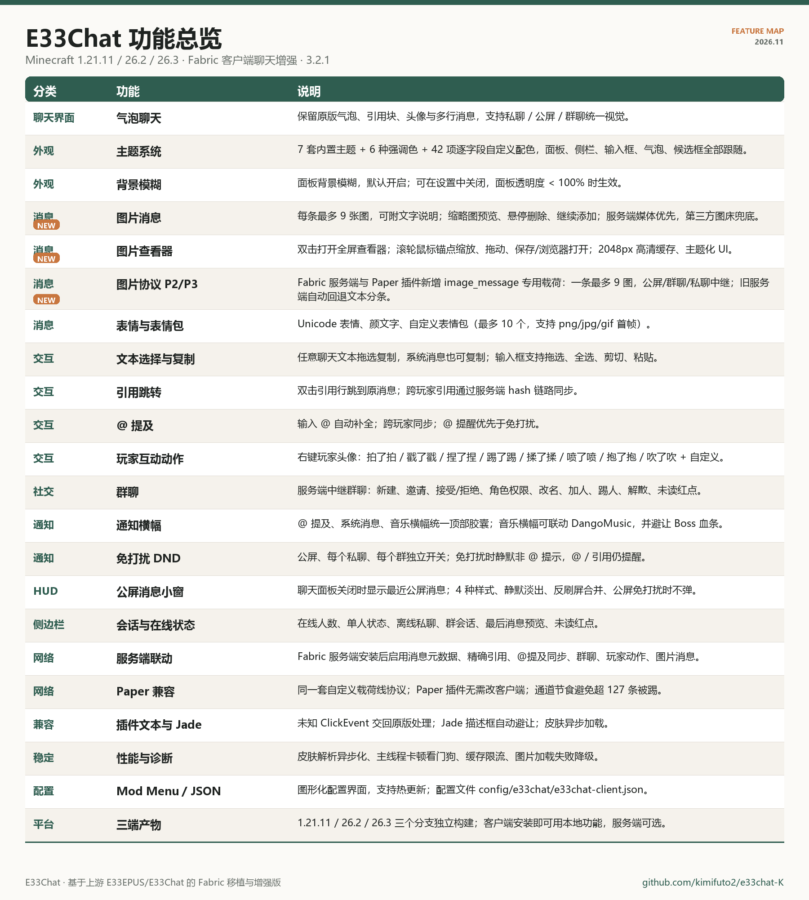

# E33Chat · Minecraft 26.3 Fabric 版

> **本分支：`mc26.3` · Minecraft 26.3（26.x 移植线）**
> 产物：**`e33chat-Fabric-26.3-3.2.1.jar`**（752,259 字节 / ≈725 KiB） · 模组版本 **3.2.1**
> 仓库：[kimifuto2/e33chat-K](https://github.com/kimifuto2/e33chat-K) · 上游：[E33EPUS/E33Chat](https://github.com/E33EPUS/E33Chat)（MIT）
>
> 在 1.21.11 移植/增强版的基础上，把客户端**移植到 Minecraft 26.3**：功能集与 `main` 分支同源，主要差异在构建链与 26.x 平台 API（见「26.x 移植说明」）。



## 分支矩阵

三个分支同属一个仓库，产物互不通用 —— 请按自己的游戏版本取对应分支的 jar：

| 分支 | Minecraft | 定位 | 产物 jar（3.2.1） | 大小 |
|---|---|---|---|---|
| `main` | 1.21.11 | 稳定线 | `e33chat-Fabric-1.21.11-3.2.1.jar` | 748,927 B |
| **`mc26.3`**（本分支） | 26.3 | 26.x 移植线 | `e33chat-Fabric-26.3-3.2.1.jar` | 752,259 B |
| `mc26.2` | 26.2 | 26.x 移植线 | `e33chat-Fabric-26.2-3.2.1.jar` | 752,312 B |

> 三个分支都在 **<https://github.com/kimifuto2/e33chat-K>** 下。**26.x 移植线**指 Mojang 改用年份版本号之后的版本，构建链与 1.21.11 差异很大（Java 25 / Gradle 9.8+ / Loom 1.19.3 / **不再混淆**）；`mc26.2` 与本分支环境基本相同，只有 Minecraft / Fabric API / 输入体系（GLFW vs SDL）不同（见「26.x 移植说明」最后一节）。

---

## 构建环境（本分支实测值）

| 项目 | 版本 / 说明 |
|---|---|
| Minecraft | **26.3** |
| Java | **25**（`options.release = 25`，toolchain 25；26.3 的 version json 里 `javaVersion.majorVersion = 25`） |
| Gradle | **9.8.2**（Loom 1.19.3 要求 **≥ 9.8**；仓库内 `gradlew` 仍指向 9.5.1，直接构建请用 Gradle 9.8.2） |
| Fabric Loom | **1.19.3**，插件 id **`net.fabricmc.fabric-loom`** → `disableObfuscation` 模式 |
| Mappings | **无** —— 26.x 的 jar 不再混淆，`build.gradle` 里**没有** `mappings` 行 |
| Fabric Loader | **0.20.1**（模组声明 `>=0.20.1`） |
| Fabric API | **`0.165.0+26.3`** |
| Mod Menu（可选） | **`19.0.0-alpha.1`**（`compileOnly`；模组建议 `>=19.0.0`） |
| 构建命令 | `gradle build`（Gradle 9.8.2） |

两点必须注意：

- **没有 mappings 行**：26.x 的 version json 不再提供 client/server mappings，声明任何 `mappings …` 都会让 Loom 直接报找不到官方 mappings；
- **依赖配置不用 `mod*`**：生态 jar 已是 Mojang 名，`modImplementation` / `modCompileOnly` 换成普通 `implementation` / `compileOnly`。

客户端模组（`environment: "*"`，含 `main` / `client` / `modmenu` 三个 entrypoint）。**服务端为可选**：服务端安装后可启用「服务器联动类功能」（消息元数据、精确引用跳转、@提及同步等）。

---

## 安装与使用

### 客户端（必需）

1. 建一个 **Minecraft 26.3 + Fabric Loader 0.20.1** 的实例；
2. 把 **Fabric API `0.165.0+26.3`** 放进实例的 `mods/`；
3. 把 **`e33chat-Fabric-26.3-3.2.1.jar`** 放进**同一个**实例的 `mods/` 目录；
4. （可选）装 **Mod Menu `19.0.0-alpha.1`**，即可获得图形化配置入口；
5. 启动游戏后聊天栏就是本模组的聊天界面，配置界面在 **Mod Menu → E33Chat → 配置**。

> 运行时 Java 由启动器提供（MC 26.3 自带 `java-runtime-epsilon`，即 Java 25）；**只有自己构建**时才需要本机 JDK 25。

### 服务端（可选，装了才有联动）

| 服务端类型 | 装什么 | 效果 |
|---|---|---|
| Fabric 服务端 **26.3** | 本分支的 `e33chat-Fabric-26.3-3.2.1.jar` | 消息元数据 / 引用精确跳转 / @提及同步全部可用 |
| Paper **26.3**（服务端需 Java 25） | `paper-plugin/` 构建出的 `E33ChatPaper-26.3-3.1.0.jar`（`paper-api` `26.3.build.222-stable`，`api-version: '26.3'`） | 线协议与客户端一致；已在 **Paper 26.3 build 222** 真机加载通过 |

---

## 26.x 移植说明

26.x 是 Mojang 换成**年份版本号**之后的第一批版本，平台变化远大于普通小版本。下面只列与本模组构建/运行直接相关的差异。

### 1. 构建链：从 Yarn + 混淆到「无 mappings + 不混淆」

| 项目 | 1.21.11（`main`） | 26.3（本分支） |
|---|---|---|
| 版本号 | `1.21.11` | `26.3`（年份版本号） |
| 混淆 / Mappings | 混淆，Yarn `1.21.11+build.6` | **jar 不再混淆 → 无 yarn/official mappings** |
| Loom 模式 | 正常 remap | **`disableObfuscation`**（Loom 按插件 id 判定） |
| Loom 插件 id | `fabric-loom` | **`net.fabricmc.fabric-loom`** |
| 依赖配置 | `modImplementation` / `modCompileOnly` | **`implementation` / `compileOnly`** |
| Loom 版本 | 1.17.19 | **1.19.3** |
| Gradle | 9.5.1 | **9.8.2**（Loom 1.19.3 要求 ≥ 9.8） |
| Java | 21 | **25**（`release 25`） |
| Fabric Loader | 0.19.3 | 0.20.1 |
| Fabric API | 0.141.5+1.21.11 | **0.165.0+26.3** |

对应到 `build.gradle` 就是这几处：

```gradle
plugins {
    // 26.x 必须用这个 id：Loom 据此把扩展设成 disableObfuscation=true
    id 'net.fabricmc.fabric-loom' version '1.19.3'
}

dependencies {
    minecraft "com.mojang:minecraft:26.3"
    // 注意：没有 mappings 行（26.x 没有 mappings 可声明）
    implementation "net.fabricmc:fabric-loader:0.20.1"
    implementation "net.fabricmc.fabric-api:fabric-api:0.165.0+26.3"
    compileOnly "com.terraformersmc:modmenu:19.0.0-alpha.1"
}
```

- 写错插件 id（用回 `fabric-loom`）或补一行 `mappings`，都会在配置阶段失败；
- 用回 `modImplementation` 不会报错但会走 remap 路径，在 26.x 上没有意义。

### 2. 输入层：26.3 起从 GLFW 换成 SDL

| 项目 | 本分支 26.3（SDL 体系） | 26.2（GLFW 体系） |
|---|---|---|
| `InputConstants.KEY_ESCAPE` | **41** | **256** |
| `KEY_RETURN` / `KEY_TAB` | 40 / 43 | 257 / 258 |
| `KEY_UP` / `KEY_NUMPADENTER` | 82 / 88 | 265 / 335 |
| 鼠标键号 | **`1`=左 / `2`=中 / `3`=右** | **`0`=左 / `1`=右 / `2`=中** |
| 鼠标按下状态 | `mouseHandler.isLeftPressed()` | 同左（`glfwGetMouseButton` 已不可用） |

> 上表数值取自两个版本 `minecraft-merged-deobf` jar 里 `com.mojang.blaze3d.platform.InputConstants` 的常量定义。

- 本分支（26.3）的 `KeyEvent.key()` / `InputWithModifiers.input()` 返回的都是 **SDL scancode**：照抄 1.21.11 的裸数字（256/257/258/262…）编译能过、运行时**静默失灵**，必须用 `InputConstants.KEY_*`；
- 本分支鼠标左键是 **1**（原版 `AbstractWidget.isValidClickButton` 就是判 `button() == 1`）：自造 `MouseButtonEvent` 必须传 1，传 0 会被原版控件当成非左键，表现为「点了完全没反应」；
- 反过来，`mc26.2` 仍是 GLFW 体系（`KEY_ESCAPE=256`、左键 `0`）：跨分支搬代码时键码与鼠标键号要**一起**改，否则会一边编过一边失灵；
- 组合键不要自己按位判断，用 `InputWithModifiers.isCopy()/isPaste()`、`hasControlDown()`。

### 3. GUI 渲染：render → extractRenderState

| 1.21.11 / 旧 API | 26.x |
|---|---|
| `Screen.render(...)` | **`extractRenderState(GuiGraphicsExtractor, …)`** |
| `Screen.renderBackground(...)` | **`extractBackground(...)`** |
| `Screen.shouldPause()` | **`isPauseScreen()`，且基类默认返回 `true`** |
| `HudRenderCallback`（Fabric） | **`HudElementRegistry.addLast(...)`**（`fabric-rendering-v1`；`HudRenderCallback` 已删除） |
| `Minecraft.setScreen(...)` | **`Gui.setScreen(...)`** |

- 26.x 的界面是「先提取渲染状态、再统一提交」，自绘控件/文本要写在 `extractRenderState` 里（子控件同样有 `extractRenderState`）；
- `isPauseScreen()` 默认 true ⇒ **聊天界面必须显式覆盖成 `false`**，否则打开聊天会把单人游戏暂停；
- 聊天文本的注入点也跟着改名：`ChatComponent.render` → `ChatComponent.extractRenderState(GuiGraphicsExtractor, Font, int, int, int, DisplayMode, boolean)`。

### 4. `mc26.2` 分支的差异

本分支（26.3）与 `mc26.2` 的构建链、Java、Loom、GUI/输入 API 基本一致，只是：

| 项目 | `mc26.3`（本分支） | `mc26.2` |
|---|---|---|
| Minecraft | 26.3 | 26.2 |
| Fabric API | `0.165.0+26.3` | `0.161.0+26.2` |
| 输入体系 | **SDL**（`KEY_ESCAPE=41`，鼠标左键 `1`） | **GLFW**（`KEY_ESCAPE=256`，鼠标左键 `0`） |

> **音乐横幅 × DangoMusic 联动**在本分支（26.3）与 `mc26.2` **同样可用，两端无 API 差异**（同一份源码，仅构建产物按 MC 版本区分）。

---

## 3.0.x 版本说明（相对上游 2.4.2）

当前版本 **3.2.1**（3.2.1 收尾 UI（底栏图标 11px、标题栏齿轮/关闭 15×15 圆角方形、时间移到标题下方、hover 不再盖描边）并合并通道机制：删除服务器白名单门控，始终注册 16 条通道，Paper 超 127 时由通道节食自动兜底；3.2.0 是**主题系统**大版本：7 套内置主题（暗色 / 米色 / 蓝色 / 绿色 / 青色 / 粉色 / 橙色）+ 6 种强调色 + 42 项逐字段自定义配色，面板/侧边栏/输入框/滚动条/气泡/候选框/通知横幅全部跟随主题；3.1.1 移除了音乐横幅的进度条；3.1.2 修复群聊二级界面输入框文字未垂直居中；3.1.3 让音乐横幅与 @ 通知横幅避让原版 Boss 血条；3.1.4 让音乐横幅在聊天面板打开时回到面板下方，并把它在设置里的名字改为「音乐横幅」；3.1.5 新增公屏小窗 4 种样式（A 纯文字 / B 半透明面板 / C 每行气泡（默认）/ D 单行跑马灯）；恢复聊天面板里的指令候选列表显示，并修复配置屏/服务器设置/通道节食三个界面的滚动条拖动不跟手。相对上游 2.4.2，本版除完成 1.21.11 → 26.3 的移植外，还包含以下增强：

| 类别 | 内容 |
|---|---|
| 免打扰 | **按会话独立**（公屏 / 每个私聊各一份）、玩家列表紫色月亮标记、名字过长省略、@提及例外 |
| 聊天小窗 | 聊天面板关闭时显示最近公屏消息，**4 种样式**（A 纯文字 / B 半透明面板 / C 每行气泡（默认）/ D 单行跑马灯），可配置静默淡出秒数、热更新、公屏免打扰时不弹出、跟随 F1 |
| 侧边栏 | 在线人数 / 单人状态行、**离线私聊玩家**（灰点）、点击玩家行不再跳回顶部 |
| 文本操作 | 任意聊天文本可拖选复制、**系统消息可复制**（右键只显示「复制」）、输入框拖选/全选/剪切 |
| 引用 | 双击引用跳转到原消息；**跨玩家引用同步**（服务端 hash 链路，他人也能看到引用条）|
| 提及 | `@名字` 跨玩家同步（Fabric 服务端与 Paper 插件同线格式）|
| 兼容 | 插件可点击文本（未知 `ClickEvent` 交回原版处理）、Jade 描述框避让、皮肤异步加载、主线程卡顿看门狗 |
| 网络 | 通道始终按连接注册/注销、**通道节食**（手动开关 + Paper 超 127 自动兜底） |
| 图片消息 | **每条最多 9 张图 + 可选文字说明**；缩略图预览/删除/继续添加；优先服务端媒体，第三方图床兜底；超长自动分条 |
| 图片查看器 | **双击打开全屏查看器**：鼠标锚点缩放、拖动、保存/浏览器打开；独立 2048px 高清缓存，主题化 UI |
| 主题 | 背景模糊默认开启（面板透明度 <100% 时生效） |

### 多图专用协议（P2 / P3）

- **P2（Fabric 服务端）**：新增 `e33chat:image_message`（C2S）与 `e33chat:image_message_relay`（S2C）；公开 / 群聊 / 私聊都按 scope 中继，一条载荷最多 9 张图，不再受原版聊天 256 字符限制。
- **P3（Paper 插件）**：Paper 端注册同一线协议并转发给范围内的在线玩家；客户端无需任何改动，图片上传仍走服务端媒体或第三方图床。
- **回退**：连接旧版 Fabric 服务端、没有该协议的 Paper 服务端，或发送载荷失败时，自动退回原有的文本分条发送。
- 服务端只中继消息内容，不保存图片二进制；图片加载仍由现有 `ImageLoader` 处理。
- **服务端媒体限流**：上传与下载分别计数（16 / 32 次每 10 秒），9 图一条消息不会因上传占满下载预算而失败。

### 图片消息与全屏查看器（3.2.1）

- **每条消息最多 9 张图片**，可附文字说明；输入框上方预览条支持悬停删除、继续添加；
- 服务端媒体优先，第三方图床兜底；支持 `image_message` 专用载荷（Fabric 服务端 / Paper 插件），一条发完 9 图；旧服务端自动回退文本分条；
- **双击图片**打开全屏查看器：滚轮以鼠标为锚点缩放、左键拖动、查看器内保存 / 浏览器打开；
- 聊天内图片显示上限 **160 逻辑 px / 320 物理 px**；查看器使用独立 **2048px** 高清缓存（最近 4 张）；
- **背景模糊默认开启**（面板透明度 < 100% 时生效）。

### 通道节食（实验性，默认关闭）

位置：**配置界面 → 高级 → 网络与服务端 → 「通道节食（实验性）」**。

- **手动开启**：在非 Fabric 服务器（如 Paper）上，按「通道节食设置」里关闭的模组与上限裁剪发往服务端的通道声明；会同时影响其它模组，默认关闭。
- **自动兜底（3.2.1 起）**：即使手动开关关闭，只要服务端 `brand` 已知且非 Fabric、且通道总数 **>127**，也会自动裁到 127，避免被 Paper 踢；自动兜底不套用你手动关闭的模组名单。
- 单机、Fabric 服务端、`brand` 未知的服务器不裁剪。

---

## 与原版的主要区别

### 聊天界面

- **主题系统**：暗 / 浅色主题 + 6 种强调色 + 自定义 HEX 配色，配置界面跟随主题
- 保留原版气泡、引用块、表情、图片消息等完整界面
- **右键二级菜单圆角化**：整块面板圆角 + 仅悬停行圆角高亮

### 交互增强

- **聊天文本选择**：鼠标拖选任意已渲染文本，`Ctrl+C` 复制；与链接点击、滚动条拖动互不冲突
- **系统消息可复制**：选中后 `Ctrl+C` 复制；右键系统消息**只显示「复制」**（无引用）
- **聊天输入框**：鼠标拖选、`Ctrl+A` 全选、复制/粘贴/剪切、选中后删除
- **引用块双击跳转**：双击消息里的引用行 → 滚动到被引用原消息并短暂高亮
  - 本地引用精确记录目标；**其他玩家的引用**在服务端安装本模组时通过 hash 链路精确定位，否则退化为内容匹配
- **链接点击**正确打开系统浏览器
- **未知文本 ClickEvent 交回原版处理**（含 `Custom` / `ShowDialog`），插件自带的可点击菜单不再「点了没反应」

### 通知与免打扰

- **免打扰（DND）**
  - 左上角月亮按钮，**按会话独立**：公屏一份，每个私聊各自一份
  - 进入私聊视图时，同一按钮自动切换为「该私聊」的开关
  - 免打扰时：不弹通知横幅（@ / 系统）、静默非 @ 提示音；**@提及 / 引用始终提醒**；**左下角红点保留**
  - 玩家列表中被免打扰的玩家显示**紫色月亮**，名字过长自动截断并加 `...`
- **公屏消息小窗**（聊天面板关闭时，**4 种视觉样式可选**）
  - 左下角聊天图标上方显示最近公屏消息；样式在 **设置 → HUD → 聊天图标 →「小窗样式」** 切换，默认 **C（每行气泡）**：

    | 样式 | 名称 | 效果 |
    |---|---|---|
    | A | 纯文字 | 无底板，白字 + 深色描边阴影，最接近原版聊天 |
    | B | 半透明面板 | 一整块半透明圆角底板，常驻显示最近 3 行 |
    | C | 每行气泡（默认） | 每行一个独立的小圆角气泡，错落堆叠 |
    | D | 单行跑马灯 | 只显示最新 1 条，新消息替换并淡入；超长自动省略 |

  - 发送者名与正文异色、长消息多行且不重复名字
  - 反刷屏：同一发送者的连续相同消息合并为一条，并在行尾以强调色显示 `×N`
  - 新消息从下往上顶、最旧淡出；**静默 5 秒**（设置中可调 1~60，热更新即时生效）后淡出
  - 公屏免打扰时不弹出；跟随 `F1` 隐藏
- **在线人数状态行**：侧边栏底部显示绿色 `【在线N人】`（含自己，与 TAB 口径一致）/ `【单人游戏中】`
- **玩家列表在线状态**：头像右下角小圆点（在线绿 / 离线灰）
- **音乐横幅 × DangoMusic 联动**（可选）
  - 与 **DangoMusic（3D 歌词音乐模组）** 同时安装时，顶部音乐横幅显示「封面 + 曲名 + 艺术家 + 播放时间（`1:26 / 3:35`）」（3.1.1 起不再画进度条；3.1.3 起屏上有 Boss 血条时自动下压到血条下方）
  - **播放中常驻**、**暂停约 1.5 秒后淡出**（与 @ 通知横幅同一动画时长）
  - 可在 **设置 → 「横幅」分组 → 「音乐横幅」** 关闭（默认开）
  - **未装 DangoMusic 时行为完全不变**；不为其自带的音乐横幅让位（如需可关闭 DangoMusic 自带的横幅）

### 兼容与稳定性

- **Jade（玉）软兼容**：显示 Jade 描述框时，通知横幅自动避让
- **皮肤解析异步化**：消除渲染线程阻塞造成的卡顿
- **主线程卡顿看门狗**：主线程长时间无 tick 时输出诊断日志
- **服务端联动通道按连接注册/注销，首次进服即可用**（见下节）

---

## 服务端联动与网络（重要）

本模组在服务端安装时可以启用**消息元数据、精确引用跳转（含其他玩家的引用）、私聊增强、@提及同步**等联动功能。

### 通道声明策略（3.2.1 起）

自定义载荷通道在**配置阶段**声明，而客户端无法提前知道服务端是否装了本模组。3.2.1 起不再按服务器地址做白名单门控：

- 每个连接边界**始终注册** E33Chat 的 16 条通道，**首次进服即可用联动**，不再需要「第二次连接才生效」；
- 断开 / 配置失败时注销，避免把上一台服务器的通道残留带到下一台；
- 旧的 `config/e33chat/e33chat-servers.txt` 不再读取，可以删除；
- 严格服兜底：在 `config/e33chat/` 下放置空文件 `no-custom-channels.flag` 可完全关闭通道声明（联动随之不可用）。

### Paper 服务端的「通道数量上限」

Paper（及部分严格服务端）对客户端声明的**通道总数**有硬上限 128（实际最多 127 条），超限时会踢人：

```
Couldn't handle custom payload on channel minecraft:register
java.lang.IllegalStateException: Cannot register channel. Too many channel registered!
→ 客户端被踢：Invalid custom payload payload!
```

这是**整合包整体通道数超限**的问题（模组越多越容易触发），E33Chat 自身只占 14 条，无法单独解决；请使用上面的**通道节食**（手动开启，或让 Paper 超限时自动兜底）。

**服务端侧解决方案**（需要服主操作）：给服务端启动参数加上

```
-Dpaper.disableChannelLimit=true
```

### 引用同步是怎么工作的

- 客户端引用消息时发送 `quote_sync`（含消息 hash、被引用消息 hash、被引用者与内容）
- **服务端收到后立即广播** `chat_meta` 给所有在线玩家（不再依赖聊天事件，因此离线模式/未签名聊天同样有效）；以 `UUID|msgHash` 做 10 秒去重，避免与聊天事件兜底路径重复广播
- 其他客户端按消息 hash 匹配消息，匹配不上就先挂起（10 秒 TTL），等消息到达后自动挂上
- 一条消息即使先到达/后到达都能正确渲染引用

---

## 配置

- 配置文件：`config/e33chat/e33chat-client.json`
- 图形界面：Mod Menu → E33Chat → 配置界面（分类开关，含 HUD / @提醒 / 主题 / 气泡等）

部分新增配置项：

| 配置项 | 说明 |
|---|---|
| `themeAccent` / `themeCustom` | 强调色 / 自定义配色 |
| `blurEnabled` | 面板背景模糊（默认开启；面板透明度 <100% 时生效） |
| `dndEnabled` | 公屏免打扰 |
| `dndWhisperPlayers` | 已设为免打扰的私聊玩家名单 |
| `publicOverlayEnabled` | 公屏消息小窗开关 |
| `publicOverlayIdleSeconds` | 小窗静默淡出秒数（1~60） |
| `publicOverlayStyle` | 小窗样式：A 纯文字 / B 半透明面板 / C 每行气泡（默认）/ D 单行跑马灯 |
| `redDotEnabled` | 左下角聊天图标红点 |
| `mentionBannerEnabled` / `systemBannerEnabled` | **通知横幅**开关：被 @ 提醒 / 系统消息（死亡、进入、广播）以顶部横幅弹出（与音乐横幅共用同一视觉容器，但独立开关） |
| `musicIslandEnabled` | **音乐横幅**（× DangoMusic：封面/曲名/艺术家/播放时间；需装 DangoMusic，默认开） |

---

## 构建

```bash
# 需要 JDK 25 与 Gradle 9.8.2（仓库内 gradlew 仍是 9.5.1，版本不够）
gradle build
```

产物：

| 文件 | 大小 |
|---|---|
| `build/libs/e33chat-Fabric-26.3-3.2.1.jar` | 752,259 B |
| `build/libs/e33chat-Fabric-26.3-3.2.1-sources.jar` | 523,738 B |

---

## paper-plugin（Paper 服务端插件）

`paper-plugin/` 是独立的 Gradle 子项目（不在根构建里），随本分支一同携带，产物为 **Paper 26.3** 服务端插件 **E33ChatPaper 3.1.0**：

| 项目 | 值 |
|---|---|
| 目标服务端 | **Paper 26.3**（build 222；服务端需 **Java 25**） |
| paper-api 坐标 | `io.papermc.paper:paper-api:26.3.build.222-stable`（`compileOnly`） |
| `paper-plugin.yml` 的 `api-version` | **`'26.3'`** |
| 产物 | `paper-plugin/build/libs/E33ChatPaper-26.3-3.1.0.jar` |
| 大小 | **72,594 B**（含 P3 图片消息中继） |
| 验证 | 已在 **Paper 26.3 build 222** 真机加载通过 |
| 作用 | 引用跨玩家同步（C2S `e33chat:quote_sync` → S2C `e33chat:chat_meta` 广播）+ @提及同步（`AsyncChatEvent` 解析 `@名字`） |

### 与 1.21.11 版（`main` 分支）的三处差别

插件**业务代码零改动**：用到的 Bukkit/Adventure API 在 1.21.11 → 26.2 → 26.3 全部同签名，26.3 / 26.2 两个插件的 **6 个 class 逐字节相同**，只有 `MANIFEST` 与 `paper-plugin.yml` 里的 `api-version` 不同。改的只是平台相关的三处：

1. **paper-api 换了版本体系**：26.x 的坐标是 `<mc>.build.<build>-<channel>`，即 `26.3.build.222-stable`，**不再是** `1.21.11-R0.1-SNAPSHOT`；旧的 `26.3-R0.1-SNAPSHOT` 目录在仓库里并不存在（那套 fill API 对 26.x 已 sunset）。
2. **`paper-plugin.yml` 的 `api-version` 写 `'26.3'`**（不是 `'1.21'`）：26.x 直接写 `<major>.<minor>`。
3. **编译与运行都要求 Java 25**：paper-api 的 class 主版本是 69（= Java 25），`paper-plugin/build.gradle` 随之用 `release 25`。

线格式与 Fabric 侧逐字节一致，客户端无需任何改动；字段表与构建方式见 [`paper-plugin/README.md`](paper-plugin/README.md)。

启动日志（26.3 build 222 实测）：

```
[E33Chat] E33ChatPaper enabled | in=e33chat:quote_sync | out=e33chat:chat_meta | dedupeWindow=10000ms | mentions=on(AsyncChatEvent)
```

> 大整合包仍需 `-Dpaper.disableChannelLimit=true`：Paper 的通道上限是 128，最多只能占 127 个（原因见上文「Paper 服务端的通道数量上限」）。

---

## 已知限制

- 本分支要求 **Java 25 + Fabric Loader 0.20.1 + Fabric API `0.165.0+26.3`**，版本不匹配会直接报 `java` / `minecraft` 依赖不满足；换到 **26.2** 请用 `mc26.2` 分支（Fabric API `0.161.0+26.2`）
- 构建需要 **Gradle 9.8+**（Loom 1.19.3），仓库内 `gradlew` 的 9.5.1 不够用
- 纯插件服 / 原版服无法提供完整的私聊联动，客户端只能按文本格式推断
- 引用精确跳转：本地引用精确；他人引用在服务端安装本模组时精确，否则按内容就近匹配（内容完全相同的多条消息可能落到邻近那条）
- 公屏小窗只在聊天面板关闭时显示
- 免打扰的横幅/声音拦截仅作用于本模组的通知系统（不影响原版与其它模组）

---

## 相关文档

- [`CHANGELOG.md`](CHANGELOG.md) —— 完整变更历史
- [`PORT_NOTES.md`](PORT_NOTES.md) —— 移植笔记（版本差异、踩坑记录）
- [`README_EN.md`](README_EN.md) —— 英文说明
- [`paper-plugin/README.md`](paper-plugin/README.md) —— Paper 服务端插件（线格式 / 构建）
- 上游项目：[E33EPUS/E33Chat](https://github.com/E33EPUS/E33Chat)

---

## 致谢与许可

- 原作者：**E33EPUS**，遵循 MIT License（见 [`LICENSE`](LICENSE)）
- 本移植版为**非官方**版本，新增功能与修复由本仓库维护；如遇问题请先确认是否与本版增强相关
- 感谢整合包社区的使用反馈与测试

> 若你只想要上游的原始功能，建议使用原项目；本版适合希望获得更完整聊天体验的玩家。
